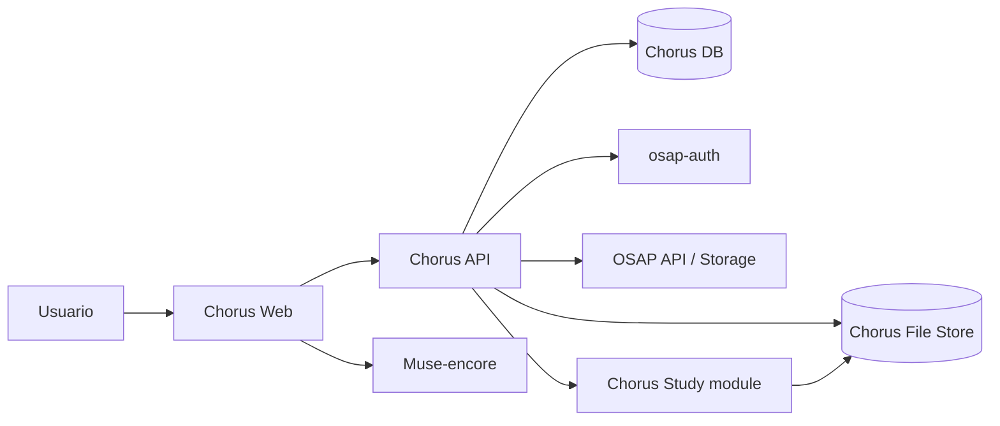

# Arquitectura de Chorus

## 1. Contexto y límites

Chorus es una aplicación independiente de OSAP, con interfaz, API, base de datos y almacenamiento propios. No es una sección de la interfaz OSAP ni una aplicación que comparta su base de datos.

OSAP aporta, en esta primera etapa, el catálogo compartido que Chorus puede buscar, consultar y leer. Chorus aporta el espacio de trabajo personal, los ficheros de las obras propias y las herramientas musicales.

### Responsabilidades

| Sistema | Responsabilidad |
|---|---|
| Chorus Web | Interfaz y escritorio personal |
| Chorus API | Reglas de negocio, autorización, biblioteca, herramientas y acceso a datos |
| Chorus DB | Usuarios referenciados, biblioteca, metadatos, índices, versiones, colecciones y relaciones |
| Chorus File Store | Ficheros de obras propias, borradores, revisiones y materiales generados |
| osap-auth | Identidad y autenticación compartidas |
| OSAP API / osap-storage | Consulta y lectura del catálogo OSAP y sus Resources/Files |
| Muse-encore | Edición musical integrada |
| Chorus Study | Módulo de generación de ejercicios y materiales de estudio coral |
| osap-support | Servicio opcional si una función futura lo requiere |

Chorus no accede directamente a las tablas internas de OSAP. Consume sus APIs de lectura. Tampoco utiliza la base de datos de OSAP para guardar su biblioteca privada.

## 2. Vista lógica

El backend Chorus media las operaciones de la aplicación. El navegador no accede directamente a las bases de datos ni al almacenamiento privado.

## 3. Dos ámbitos de contenido

### 3.1 Obras consultadas en OSAP

- Chorus busca y consulta Works y Resources mediante la API OSAP.
- El usuario puede incorporar una referencia a un Resource en su biblioteca.
- Chorus conserva el identificador externo y los datos mínimos necesarios para mostrar la referencia o una caché identificada como tal.
- El contenido y los metadatos canónicos siguen perteneciendo a OSAP.
- En esta primera etapa el flujo es de lectura: Chorus no modifica ni publica en OSAP.

Una referencia a OSAP no se convierte automáticamente en una obra propia ni se copia al almacenamiento privado.

### 3.2 Obras propias de Chorus

- El usuario puede crear o incorporar una obra propia sin que exista una Work en OSAP.
- El contenido se guarda como uno o varios ficheros en el nuevo formato de Chorus.
- Chorus DB registra la identidad local, título, metadatos, relaciones, versiones, formato y referencias a los ficheros.
- Chorus File Store conserva los bytes de los ficheros.
- La base de datos no sustituye al contenido musical y el fichero no sustituye a los metadatos e índices.
- Las versiones son independientes: una edición genera un nuevo fichero/revisión, sin destruir el anterior.

El diseño exacto del formato de ficheros y de su esquema de metadatos queda pendiente de especificación y versionado.

## 4. Identidad y autorización

- La identidad se obtiene de osap-auth; Chorus no crea contraseñas ni un proveedor de identidad paralelo.
- Chorus mantiene su propia base de datos de aplicación y vincula los datos personales al identificador estable del sujeto autenticado.
- Toda operación privada se autoriza en el backend.
- Las membresías de grupos no conceden acceso automático a toda la biblioteca personal.
- Salir de un grupo no elimina el espacio personal ni sus ficheros.
- Las responsabilidades de grupo son contextuales, no perfiles globales excluyentes.

## 5. Modelo de contenido compatible con V6

Para las referencias externas OSAP se respetan sus conceptos:
- Work: obra canónica.
- Resource: interpretación, arreglo o edición concreta.
- File: fichero físico asociado al Resource.

Estos conceptos no obligan a que Chorus replique el catálogo OSAP en su propia base de datos. Chorus mantiene referencias externas.

Para el contenido propio, Chorus tendrá identidad y modelo locales. No se debe fingir que una obra privada ya tiene un identificador Work/Resource de OSAP. La futura publicación, si se incorpora, será un proceso explícito de exportación/alta a OSAP y no parte de la lectura inicial.

## 6. Herramientas dentro de Chorus

Las herramientas comparten usuario, biblioteca, autorización y almacenamiento:
- Muse-encore trabaja sobre ficheros propios o copias de trabajo derivadas de recursos consultados.
- Chorus Study recibe datos musicales adecuados desde la biblioteca o desde una partitura autorizada y genera materiales de estudio.
- Los resultados se guardan en el espacio propio de Chorus y se relacionan con la obra/recurso de origen.

El módulo de estudio no tiene usuarios, biblioteca ni base de datos separados.

## 7. Despliegue y configuración

- Chorus tendrá repositorio, configuración, API, base de datos y almacenamiento propios.
- Mantendrá un `osap.toml` propio siguiendo el patrón de aplicaciones OSAP separadas.
- Los secretos se configuran por entorno y no se guardan en Git.
- La integración con osap-auth y OSAP se realiza mediante adaptadores.
- No se presupone que osap-storage sea el almacén de los ficheros privados de Chorus.

## 8. Principios de implementación

- Contratos explícitos y versionados para el formato de ficheros propio.
- Separación entre dominio Chorus y adaptadores OSAP.
- Identificadores externos opacos; no usar claves internas de OSAP como identidad local.
- Migraciones explícitas y pruebas de recuperación de ficheros.
- Pruebas de autorización y propiedad.
- Sin escrituras en bases de datos de producción OSAP durante esta etapa.
- La primera versión debe poder probarse con servicios OSAP simulados.
