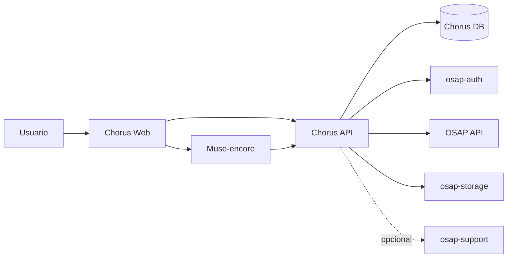

# Arquitectura de Chorus

## 1. Contexto y límites

Chorus es una aplicación independiente, con interfaz y experiencia propias. OSAP aporta el catálogo musical, la identidad y los servicios de almacenamiento; Chorus aporta el espacio de trabajo personal y las herramientas de colaboración.

La aplicación no debe incrustarse como una sección de la interfaz web de OSAP ni depender de sus pantallas. La integración se realiza mediante APIs y contratos explícitos.

### Responsabilidades

| Sistema | Responsabilidad |
|---|---|
| Chorus | Escritorio, biblioteca personal, colecciones, repertorios, borradores, contactos, grupos, secciones, agenda y distribución |
| osap-auth | Identidad, autenticación y contexto de usuario |
| OSAP API | Catálogo de Works, búsqueda y resolución de identidad de obras |
| osap-storage | Resources, Files, metadatos de almacenamiento y operaciones de publicación |
| Muse-encore | Edición musical embebida o integrada para MusicXML/MXL |
| osap-support | Servicios de soporte cuando una función concreta lo requiera; no es dependencia del núcleo |

Chorus no accede directamente a las tablas internas de OSAP ni escribe en sus bases de datos. Consume contratos de API. No mantiene una copia paralela del catálogo.

## 2. Vista lógica

La interfaz no debe llamar directamente a las bases de datos ni asumir que un identificador interno de OSAP es una URL pública estable. La API de Chorus media las operaciones del espacio personal y aplica las reglas de autorización.

## 3. Separación de datos

Chorus conserva datos propios:
- pertenencia de cada elemento al espacio personal;
- colecciones y ordenaciones;
- etiquetas, notas y preferencias personales;
- borradores y versiones privadas;
- contactos y relaciones de colaboración;
- grupos, secciones, membresías y eventos;
- distribuciones y confirmaciones.

Chorus referencia datos OSAP:
- Work canónica;
- Resource concreto;
- File asociado al Resource, cuando la API lo exponga.

No copia títulos, autorías o metadatos canónicos para convertirlos en una segunda fuente de verdad. Puede guardar una instantánea técnica mínima para continuidad o caché, siempre identificada como tal y con política de actualización.

## 4. Autenticación y autorización

- La identidad se obtiene de osap-auth; Chorus no crea una identidad de usuario paralela.
- El identificador de usuario de la identidad autenticada es la clave de propiedad del espacio personal.
- Toda operación privada se autoriza en servidor, no solo ocultando controles en la interfaz.
- Las membresías de grupos no conceden acceso a toda la biblioteca personal.
- Salir de un grupo no elimina el espacio personal ni los elementos que pertenecen al usuario.
- Las capacidades dentro de un grupo se expresan mediante responsabilidades y permisos asignados a la membresía, no mediante perfiles globales excluyentes.

## 5. Flujo de importación desde OSAP

1. El usuario busca una obra o Resource desde Chorus.
2. Chorus consulta la API de OSAP.
3. El usuario elige el Resource concreto.
4. Chorus crea un WorkspaceItem que referencia ese Resource.
5. Las colecciones y repertorios organizan esa referencia sin duplicar el Resource.

Añadir un Resource al escritorio no descarga ni clona necesariamente el fichero. La disponibilidad y el acceso al File se resuelven mediante osap-storage y sus permisos.

## 6. Flujo de edición y publicación

1. El usuario abre un Resource o un archivo propio compatible en Muse-encore.
2. Chorus conserva el original como referencia inmutable.
3. La edición se guarda como Draft y genera revisiones privadas.
4. Al publicar, Chorus envía el contenido y el contexto a la API de OSAP.
5. OSAP resuelve si la Work ya existe y aplica las reglas de creación.
6. Si la Work existe, se crea un nuevo Resource; nunca se sustituye el Resource original.
7. Si no existe, OSAP crea la Work y su primer Resource según sus propias reglas.

Chorus no decide por sí solo que dos obras son la misma ni crea identidades canónicas de Work. Esa resolución pertenece a OSAP.

En el modelo V6:
- Work representa la obra canónica.
- Resource representa una interpretación, arreglo o edición concreta.
- File representa el fichero físico.
- La autoría de la obra pertenece a Work; la procedencia y los derechos del Resource se mantienen separados.
- Uploader, composer y license-owner son conceptos distintos.

Una edición de una Work ajena no concede permiso para modificar la Work: se publica como nuevo Resource, con la atribución y derechos correspondientes. Los borradores permanecen privados hasta que el usuario decide compartirlos o publicarlos.

## 7. Almacenamiento privado

Los ficheros privados se gestionan mediante osap-storage, no mediante rutas locales ni objetos gestionados directamente por Chorus. Chorus conserva las relaciones y metadatos propios del espacio de trabajo.

El diseño debe permitir que el usuario archive MusicXML/MXL y otros formatos admitidos como recursos privados, sin exigir que exista una Work pública.

## 8. Despliegue y configuración

- Chorus tendrá su propio repositorio, configuración y despliegue.
- Mantendrá un `osap.toml` propio, siguiendo el patrón de las aplicaciones OSAP separadas.
- Los endpoints, claves y credenciales se configuran por entorno; no se incluyen secretos en Git.
- Las dependencias externas deben estar detrás de adaptadores para facilitar pruebas y cambios de contrato.
- No se presupone proveedor de pago, monetización ni dependencia obligatoria de osap-support.

## 9. Principios de implementación

- API-first y contratos versionados.
- Separación clara entre dominio Chorus y adaptadores OSAP.
- Identificadores internos opacos; no exponer claves de base de datos como identificadores públicos mutables.
- Migraciones explícitas y reversibles.
- Pruebas de autorización para propiedad personal, membresías y recursos compartidos.
- Ninguna escritura en producción OSAP durante el desarrollo inicial.
- La primera versión debe poder funcionar con servicios OSAP simulados en pruebas.
