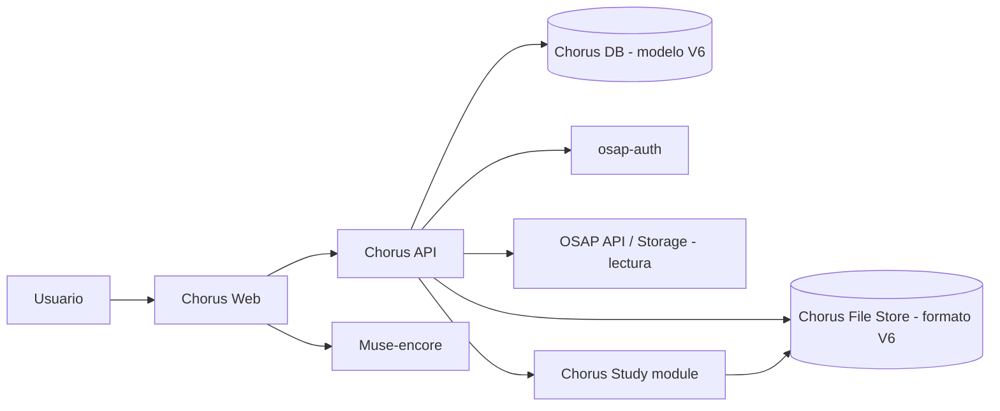

# Arquitectura de Chorus

## 1. Contexto y límites

Chorus es una aplicación independiente de OSAP, con interfaz, API y base de datos propias. No es una sección de la interfaz OSAP ni comparte su base de datos de producción.

Chorus adopta el modelo y el formato V6 de osap-storage para sus propias obras. La independencia de Chorus significa que mantiene su propia persistencia y ciclo de vida; no significa que invente otro formato de Work, Resource o File.

OSAP aporta, en esta primera etapa, el catálogo compartido que Chorus puede buscar, consultar y leer. Chorus aporta el espacio de trabajo personal y las herramientas musicales.

### Responsabilidades

| Sistema | Responsabilidad |
|---|---|
| Chorus Web | Interfaz y escritorio personal |
| Chorus API | Reglas de negocio, autorización, biblioteca, herramientas y acceso a datos |
| Chorus DB | Persistencia propia de Chorus, compatible con el modelo V6 |
| Chorus File Store | Ficheros propios organizados según el formato V6 |
| osap-auth | Identidad y autenticación compartidas |
| OSAP API / osap-storage | Consulta y lectura del catálogo OSAP |
| Muse-encore | Edición musical integrada |
| Chorus Study | Módulo de generación de ejercicios y materiales de estudio coral |
| osap-support | Servicio opcional si una función futura lo requiere |

Chorus no accede directamente a las tablas internas de OSAP. Consume sus APIs de lectura. Tampoco utiliza la base de datos de OSAP para guardar su biblioteca privada.

## 2. Vista lógica

El backend Chorus media las operaciones de la aplicación. El navegador no accede directamente a las bases de datos ni al almacenamiento privado.

## 3. Dos ámbitos de contenido

### 3.1 Obras consultadas en OSAP

- Chorus busca y consulta Works y Resources mediante la API OSAP.
- El usuario puede incorporar una referencia a un Resource en su biblioteca.
- Chorus conserva el identificador externo y los datos mínimos necesarios para mostrar la referencia o una caché identificada como tal.
- El contenido y los metadatos canónicos siguen perteneciendo a OSAP.
- En esta primera etapa el flujo es de lectura: Chorus no modifica ni publica en OSAP.

Una referencia a OSAP no se convierte automáticamente en una obra propia ni se copia al almacenamiento privado.

### 3.3 Creación desde la API

El flujo de creación se orquesta exclusivamente mediante Chorus API:

1. el usuario puede buscar una obra en OSAP y elegir una representación, o iniciar una partitura en blanco;
2. Chorus crea un Draft de aplicación, fuera de las tablas V6 Work/Resource/File;
3. si se eligió OSAP, Chorus obtiene la partitura mediante las APIs públicas de OSAP y la ofrece a MuseEncore mediante una URL temporal firmada;
4. MuseEncore abre la partitura mediante su parámetro documentado `?url`, o presenta su pantalla de nueva partitura;
5. el usuario exporta MusicXML comprimido (.mxl) y lo carga a Chorus mediante la API;
6. Chorus valida el fichero y materializa Work → Resource → File en una única transacción.

El editor externo no recibe acceso a la base de datos, al almacenamiento privado ni a un token OIDC reutilizable. Su origen web solo recibe una URL temporal de lectura con expiración y CORS restringido. El `.mxl` exportado se devuelve a Chorus mediante una carga autenticada.

### 3.2 Obras propias de Chorus

- El usuario puede crear o incorporar una obra propia sin que exista una Work en el catálogo OSAP.
- Las obras propias se representan con el modelo V6: Work, Resource y File, según corresponda a su significado musical.
- Los ficheros y sus metadatos siguen el formato V6 definido por osap-storage; no se crea un formato propietario Chorus.
- Chorus DB mantiene la persistencia propia de estas entidades, sus relaciones, índices, versiones y referencias a ficheros.
- El almacenamiento propio de Chorus conserva los ficheros.
- Las versiones son independientes: una edición genera una nueva revisión/fichero conforme a las reglas V6, sin destruir la versión anterior.

La implementación debe contrastarse con el esquema, los contratos y las reglas de integridad V6 reales. No se deben deducir campos ni estructuras a partir de nombres conceptuales.

## 4. Identidad y autorización

- La identidad se obtiene de osap-auth; Chorus no crea contraseñas ni un proveedor de identidad paralelo.
- Chorus mantiene su propia base de datos de aplicación y vincula los datos personales al identificador estable del sujeto autenticado.
- Toda operación privada se autoriza en el backend.
- Las membresías de grupos no conceden acceso automático a toda la biblioteca personal.
- Salir de un grupo no elimina el espacio personal ni sus ficheros.
- Las responsabilidades de grupo son contextuales, no perfiles globales excluyentes.

## 5. Modelo de contenido V6

Para las obras propias y para las referencias al catálogo se respetan los conceptos V6:
- Work: obra.
- Resource: interpretación, arreglo o edición concreta.
- File: fichero físico asociado al Resource.

La base de datos de Chorus será propia, pero utilizará el modelo y formato V6 de osap-storage. Debe distinguirse entre:
- **formato/modelo:** compatible con V6;
- **persistencia:** instancia y datos propios de Chorus;
- **catálogo OSAP:** servicio externo consultado en modo lectura en la primera etapa.

No se asignarán identificadores de OSAP a las obras privadas de Chorus. Los identificadores locales se gestionarán en el ámbito propio de Chorus, respetando las reglas V6 que correspondan. La publicación futura en OSAP será un proceso explícito de exportación/alta, no parte de la lectura inicial.

## 6. Herramientas dentro de Chorus

Las herramientas comparten usuario, biblioteca, autorización y persistencia:
- Muse-encore trabaja sobre ficheros propios o copias de trabajo derivadas de recursos consultados.
- Chorus Study recibe datos musicales desde una obra propia o desde una partitura OSAP autorizada y genera materiales de estudio.
- Los resultados se guardan en Chorus y se relacionan con la obra/recurso de origen, utilizando el modelo de ficheros acordado para Chorus.

El módulo de estudio no tiene usuarios, biblioteca ni base de datos separados.

## 7. Despliegue y configuración

- Chorus tendrá repositorio, configuración, API y base de datos propios.
- Mantendrá un `osap.toml` propio siguiendo el patrón de aplicaciones OSAP separadas.
- Los secretos se configuran por entorno y no se guardan en Git.
- La integración con osap-auth y OSAP se realiza mediante adaptadores.
- La base de datos y almacenamiento propios deben implementar el formato/modelo V6, sin conectarse a la base de datos de producción OSAP.

## 8. Principios de implementación

- Reutilizar el modelo y formato V6; no crear un esquema de ficheros paralelo.
- Contrastar los contratos y restricciones V6 reales antes de implementar.
- Separar dominio Chorus, persistencia propia y adaptadores OSAP.
- Identificadores externos opacos; no usar claves internas de OSAP como identidad local.
- Migraciones explícitas y pruebas de integridad entre registros y ficheros.
- Pruebas de autorización y propiedad.
- Sin escrituras en bases de datos de producción OSAP durante esta etapa.
- La primera versión debe poder probarse con servicios OSAP simulados.
