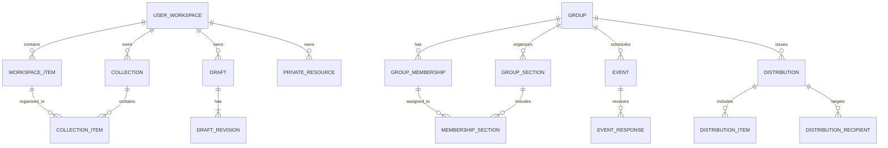

# Modelo de dominio de Chorus

Este documento define el modelo funcional inicial. Es un modelo lógico, no todavía un esquema SQL ni una decisión de ORM. Los nombres podrán adaptarse a convenciones del código, pero no deben alterar las responsabilidades descritas.

## 1. Regla de propiedad

Cada usuario tiene un espacio personal permanente. Los elementos personales pertenecen al usuario, no a un coro, orquesta o grupo. Un grupo puede recibir acceso explícito a elementos o copias distribuidas, pero la membresía no transfiere la propiedad.

Una persona puede pertenecer a varios grupos y mantener una única biblioteca personal.

## 2. Entidades principales

### UserWorkspace

Espacio personal asociado uno a uno con el identificador de usuario de osap-auth.

Campos conceptuales:
- id
- owner_user_id
- created_at
- updated_at
- preferences

No contiene una copia del perfil de identidad.

### WorkspaceItem

Elemento que aparece en la biblioteca personal. Es la relación entre el espacio y un objeto musical.

Puede referenciar:
- un Resource de OSAP;
- un PrivateResource de Chorus.

Campos conceptuales:
- id
- workspace_id
- item_kind
- osap_resource_id (nullable)
- private_resource_id (nullable)
- display_order
- personal_title (nullable)
- notes (nullable)
- added_at
- archived_at (nullable)

Debe existir exactamente una referencia válida según item_kind. El título personal es una etiqueta del usuario, no una modificación del título canónico.

### Collection

Colección personal para organizar elementos de la biblioteca. Puede anidarse si la experiencia lo necesita, pero la primera versión puede usar colecciones planas.

Campos:
- id
- workspace_id
- name
- description
- sort_order
- created_at
- updated_at

### CollectionItem

Relación entre Collection y WorkspaceItem. Un elemento puede pertenecer a varias colecciones.

Campos:
- collection_id
- workspace_item_id
- sort_order
- added_at

### PrivateResource

Recurso musical privado cuyo contenido y metadatos pertenecen al usuario. No requiere que exista una Work pública.

Campos conceptuales:
- id
- owner_user_id
- title
- description
- format
- storage_file_id
- source_workspace_item_id (nullable)
- created_at
- updated_at
- visibility

El almacenamiento físico se gestiona mediante osap-storage. Chorus no inventa rutas ni ubicaciones físicas.

### Draft

Trabajo en curso asociado opcionalmente a un Resource de OSAP o a un PrivateResource.

Campos:
- id
- workspace_id
- base_osap_resource_id (nullable)
- base_private_resource_id (nullable)
- title
- status
- current_revision_id
- created_at
- updated_at

### DraftRevision

Revisión inmutable del contenido de un Draft.

Campos:
- id
- draft_id
- revision_number
- storage_file_id
- editor_metadata
- created_at
- created_by_user_id

Cada guardado significativo crea una revisión o un punto de recuperación definido por el editor. No se actualiza el fichero original.

## 3. Contactos y colaboración (fase posterior)

### Contact

Relación personal entre dos usuarios. No implica acceso automático a bibliotecas o borradores.

### Group

Agrupación musical o de colaboración: coro, orquesta, conjunto, grupo de cámara, equipo de proyecto u otra comunidad.

### GroupMembership

Relación entre usuario y Group. Contiene estado de membresía y responsabilidades dentro de ese grupo.

### GroupSection

Subdivisión organizativa de un Group, por ejemplo cuerda, voz, sección instrumental o equipo de trabajo.

### MembershipSection

Relación entre membresía y sección. Una persona puede pertenecer a más de una sección cuando la organización lo permita.

Los permisos de dirección, administración, edición de repertorio o distribución se modelan como capacidades de la membresía, no como un tipo global de usuario.

## 4. Agenda y distribución (fase posterior)

### Event

Ensayo, reunión, concierto, audición u otra actividad vinculada opcionalmente a un Group.

### EventResponse

Confirmación, rechazo o respuesta pendiente de un usuario invitado.

### Distribution

Envío controlado de uno o varios elementos musicales a destinatarios concretos: usuarios, secciones o el grupo completo.

### DistributionItem

Elemento incluido en una distribución.

### DistributionRecipient

Destinatario y estado de entrega/consulta cuando proceda.

La distribución no mueve la propiedad del elemento original. Puede referenciar un Resource OSAP, un elemento compartido o una copia autorizada.

## 5. Relaciones

La relación con usuarios de osap-auth se representa mediante sus identificadores, sin crear una tabla local de identidades duplicada. El diagrama omite esa referencia externa para facilitar la lectura.

## 6. Invariantes

1. Un usuario tiene un único UserWorkspace.
2. Un WorkspaceItem pertenece a un único UserWorkspace.
3. Un WorkspaceItem referencia un Resource OSAP o un PrivateResource, no ambos.
4. Un elemento puede estar en varias Collections.
5. Una Collection y un Draft no se comparten por defecto.
6. La pertenencia a un Group no concede acceso a todo el Workspace.
7. La salida de un Group no elimina WorkspaceItems, PrivateResources ni Drafts personales.
8. Un DraftRevision es inmutable.
9. Editar un Resource OSAP nunca sobrescribe su File ni su Resource.
10. Solo OSAP resuelve la identidad canónica de Work y crea nuevos Resources públicos.
11. La autoría de Work no se confunde con quien sube un fichero ni con el titular de la licencia del Resource.
12. La autorización se comprueba en servidor en cada lectura y escritura.

## 7. Fuera del primer esquema

No se implementan todavía pagos, facturación, chat general, red social pública, gestión de derechos compleja ni sincronización de archivos entre proveedores. Se añadirán solo si un caso de uso validado lo requiere.
