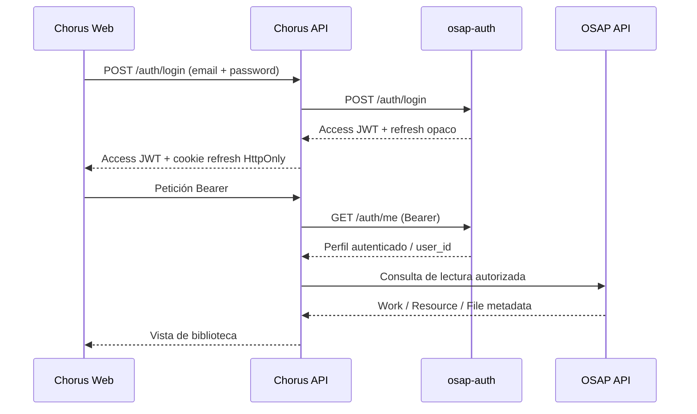

# Contratos de integración: estado comprobado y límites

Este documento distingue contratos observados de decisiones pendientes. Chorus es independiente y conserva sus datos en su propia base de datos y almacenamiento, pero adopta el modelo y formato V6 de osap-storage.

## 1. Identidad: osap-auth

Chorus delega la identidad en osap-auth. El runtime utiliza POST /auth/login y POST /auth/refresh con la audiencia predeterminada de Auth. El refresh se mantiene en cookie HttpOnly, Secure y SameSite=Lax. Chorus no valida localmente el JWT: reenvía el Bearer a GET /auth/me, que verifica firma, emisor y audiencia en osap-auth, y usa el user_id de la respuesta para aplicar propiedad y permisos. En las llamadas de catálogo y descarga también reenvía el Bearer a osap-api, que es su audiencia prevista, para mantener las cuotas y la analítica asociadas al usuario. Véase authentication-runtime.md.

El flujo OIDC PKCE que AI_GAMEPC2 utiliza hoy está configurado para su propia SPA y audiencia osap-api. Chorus no reutiliza el token como si fuera una credencial emitida para Chorus; lo presenta únicamente ante el endpoint /auth/me de osap-auth, que es el servicio destinado a validarlo.

## 2. Catálogo OSAP: lectura

En esta primera etapa Chorus consume OSAP para buscar, consultar y leer Works, Resources y sus Files mediante APIs oficiales.

- No accede directamente a tablas de OSAP.
- No escribe en la base de datos de OSAP.
- No copia el catálogo completo.
- Guarda referencias externas y, si hace falta, cachés de presentación claramente identificadas.
- Trata los identificadores OSAP como opacos.

## 3. Persistencia propia de Chorus y formato V6

Chorus dispone de una instancia de base de datos y almacenamiento propios. Para representar sus obras, recursos y ficheros adopta el modelo lógico Work → Resource → File de V6 de osap-storage. El código y el DDL actuales de AI_osap-storage aún corresponden al modelo anterior y su propuesta OpenAPI V6 no es un contrato desplegado. Por ello, Chorus incorpora una implementación piloto propia, sin copiar el esquema antiguo de Storage.

La migración SQLite de referencia está en migrations/sqlite/001_v6_work_resource_file.sql y sus pruebas en tests/test_v6_schema.py. Utiliza claves foráneas diferidas para exigir que cada Work tenga un Resource y cada Resource un File al confirmar la transacción. SQLite es aquí un banco de pruebas; no se ha elegido como motor definitivo.

El workflow V6 schema tests se ejecutó en GitHub Actions y terminó con 6 pruebas correctas (6 passed). Esto valida la migración y sus invariantes en SQLite, no el contrato V6 completo ni el motor definitivo.

El piloto no equivale a congelar el contrato V6 completo. Antes de convertirlo en persistencia de producción quedan por cerrar los créditos, las clasificaciones normalizadas, los vocabularios, la serialización canónica, el motor definitivo y la política del almacenamiento físico. El puntero interno del File no se expone en DTO; SHA-256 no es identidad ni clave única.

La base de datos propia de Chorus registrará las entidades musicales Work/Resource/File y, separadamente, las relaciones personales, permisos y revisiones de la aplicación. La independencia de Chorus es de aplicación y persistencia, no de formato.

Véase v6-pilot-schema.md para las decisiones y límites del DDL de referencia.

## 4. ScoreContract

El ScoreContract anterior es un contrato específico para alimentar el generador de materiales de estudio. No sustituye los contratos V6 Work/Resource/File ni el modelo de datos propio de Chorus.

Véase score-contract-review.md y study-module.md.

## 5. Flujo de consulta

El flujo de login, refresh e introspección mediante /auth/me está implementado en el runtime piloto.

## 6. Verificaciones pendientes

- [ ] Contrastar el esquema, serialización e invariantes V6 completos en osap-storage.
- [ ] Elegir el motor definitivo y traducir/probar las restricciones en ese motor.
- [x] Verificar claims, JWKS, issuer/audience y endpoints de login/refresh de osap-auth; el piloto usa la audiencia predeterminada `osap-api` (decisión CH-016). `chorus-api` queda pendiente como endurecimiento, no como requisito del piloto.
- [ ] Revisar OpenAPI OSAP de la versión desplegada.
- [ ] Identificar endpoints reales de búsqueda de Work, consulta de Resource y lectura de File.
- [ ] Definir caché de metadatos y tratamiento de referencias no disponibles.
- [ ] Definir respaldo, integridad y recuperación de los ficheros propios.
- [ ] Diseñar publicación/exportación a OSAP en una fase posterior.

No se codifican URLs, scopes, campos ni payloads supuestos.

## 7. Creación desde OSAP o desde una partitura nueva

El flujo funcional y los endpoints de Chorus están especificados en [work-creation-api.md](work-creation-api.md). Los contratos OSAP observados en el código actual son:

- `POST /api/v1/searches` y `GET /api/v1/searches/{search_id}`;
- `GET /api/v1/representations/{representation_id}`;
- `GET /api/v1/representations/{representation_id}/download`;
- `GET /api/v1/works/public/{work_id}`.

El usuario puede elegir una representación OSAP compatible con MuseEncore o iniciar una partitura en blanco. La descarga se realiza desde Chorus hacia OSAP por API, y el original nunca se modifica.

MuseEncore admite la apertura por URL con `?url=...` y exporta MusicXML comprimido `.mxl`. No se ha encontrado un callback/API pública para exportar directamente al servidor Chorus. Por eso la primera integración requiere que el usuario descargue el `.mxl` exportado y lo cargue mediante la API Chorus. No se modifica el repositorio MuseEncore.

La migración `migrations/sqlite/002_creation_drafts.sql` mantiene los borradores y tokens temporales fuera de las entidades V6. Las seis pruebas de borradores, junto con las seis de cardinalidad V6, pasan en GitHub Actions (12 passed).
