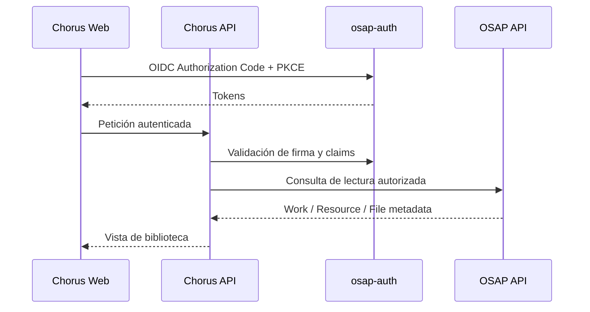

# Contratos de integración: estado comprobado y límites

Este documento distingue contratos observados de decisiones pendientes. Chorus es independiente y conserva sus datos privados en su propia base de datos y almacenamiento.

## 1. Identidad: osap-auth

El repositorio `AI_osap-auth` implementa un proveedor OIDC con discovery, Authorization Code + PKCE S256, JWKS y firma RS256. Chorus utilizará osap-auth como proveedor de identidad, pero mantendrá sus propios usuarios de aplicación, espacios personales y permisos.

El sujeto autenticado (`sub`) será la referencia externa de propiedad. No se guardarán contraseñas ni se creará un login paralelo. Los detalles de issuer, audience, claims, scopes y registro de cliente deben contrastarse con la configuración real antes de implementar.

## 2. Catálogo OSAP: lectura

En esta primera etapa Chorus consume OSAP para buscar, consultar y leer Works, Resources y sus Files mediante APIs oficiales.

- No accede directamente a tablas de OSAP.
- No escribe en la base de datos de OSAP.
- No copia el catálogo completo.
- Guarda referencias externas y, si hace falta, cachés de presentación claramente identificadas.
- Trata los identificadores OSAP como opacos.

Los conceptos V6 Work → Resource → File describen el catálogo OSAP y no se convierten automáticamente en las entidades locales de Chorus.

## 3. Persistencia propia de Chorus

Chorus dispone de:
- Chorus DB para identidad local de aplicación, espacios personales, metadatos, índices, colecciones, versiones y relaciones.
- Chorus File Store para los ficheros de obras propias, borradores, revisiones y materiales generados.

Los ficheros propios usan un formato musical versionado de Chorus, pendiente de especificación. La base de datos conserva metadatos, referencias, checksums y versiones; el almacenamiento conserva los bytes.

No se presupone que osap-storage almacene los ficheros privados de Chorus. Esa es una decisión de arquitectura propia. La publicación futura en OSAP, si se desarrolla, será una exportación explícita y usará los contratos OSAP correspondientes.

## 4. ScoreContract

El `ScoreContract` anterior es un contrato específico para alimentar el generador de materiales de estudio. No sustituye los contratos OSAP Work/Resource/File ni el modelo de datos propio de Chorus.

Véase [score-contract-review.md](score-contract-review.md) y [study-module.md](study-module.md).

## 5. Flujo de consulta

Es un flujo conceptual; no fija rutas, scopes ni payloads que todavía no hayan sido comprobados.

## 6. Verificaciones pendientes

- [ ] Confirmar issuer, audience, claims y registro de cliente OIDC.
- [ ] Revisar OpenAPI OSAP de la versión desplegada.
- [ ] Identificar endpoints reales de búsqueda de Work, consulta de Resource y lectura de File.
- [ ] Definir caché de metadatos y tratamiento de referencias no disponibles.
- [ ] Especificar formato propio de ficheros y esquema de Chorus DB.
- [ ] Definir respaldo, integridad y recuperación de Chorus File Store.
- [ ] Diseñar publicación/exportación a OSAP en una fase posterior.
- [ ] Añadir pruebas de contrato y de integración en entorno no productivo.

No se codifican URLs, scopes ni payloads supuestos.
