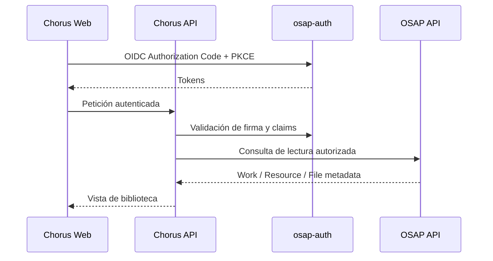

# Contratos de integración: estado comprobado y límites

Este documento distingue contratos observados de decisiones pendientes. Chorus es independiente y conserva sus datos en su propia base de datos y almacenamiento, pero adopta el modelo y formato V6 de osap-storage.

## 1. Identidad: osap-auth

El repositorio `AI_osap-auth` implementa un proveedor OIDC con discovery, Authorization Code + PKCE S256, JWKS y firma RS256. Chorus utilizará osap-auth como proveedor de identidad, pero mantendrá sus propios usuarios de aplicación, espacios personales y permisos.

El sujeto autenticado (`sub`) será la referencia externa de propiedad. No se guardarán contraseñas ni se creará un login paralelo. Los detalles de issuer, audience, claims, scopes y registro de cliente deben contrastarse con la configuración real antes de implementar.

## 2. Catálogo OSAP: lectura

En esta primera etapa Chorus consume OSAP para buscar, consultar y leer Works, Resources y sus Files mediante APIs oficiales.

- No accede directamente a tablas de OSAP.
- No escribe en la base de datos de OSAP.
- No copia el catálogo completo.
- Guarda referencias externas y, si hace falta, cachés de presentación claramente identificadas.
- Trata los identificadores OSAP como opacos.

## 3. Persistencia propia de Chorus y formato V6

Chorus dispone de una instancia de base de datos y almacenamiento propios. Para representar sus obras, recursos y ficheros adopta el modelo, formato, estructura e invariantes V6 de osap-storage.

Esto significa:
- no crear un formato de fichero Chorus alternativo;
- no inventar una segunda semántica para Work, Resource o File;
- contrastar el esquema V6 real antes de definir tablas, campos o serialización;
- mantener los datos privados en la instancia Chorus, sin escribir en la base de datos de producción OSAP;
- mantener identificadores del ámbito Chorus separados de los identificadores del catálogo OSAP.

La base de datos registra metadatos, relaciones, índices, versiones y referencias a ficheros conforme al modelo V6. El almacenamiento propio conserva los ficheros en el formato V6.

La independencia de Chorus es de aplicación y persistencia, no de formato.

## 4. ScoreContract

El `ScoreContract` anterior es un contrato específico para alimentar el generador de materiales de estudio. No sustituye los contratos V6 Work/Resource/File ni el modelo de datos propio de Chorus.

Véase [score-contract-review.md](score-contract-review.md) y [study-module.md](study-module.md).

## 5. Flujo de consulta

Es un flujo conceptual; no fija rutas, scopes ni payloads que todavía no hayan sido comprobados.

## 6. Verificaciones pendientes

- [ ] Contrastar el esquema, serialización e invariantes V6 completos en osap-storage.
- [ ] Definir cómo se implementará ese contrato en la instancia propia de Chorus.
- [ ] Confirmar issuer, audience, claims y registro de cliente OIDC.
- [ ] Revisar OpenAPI OSAP de la versión desplegada.
- [ ] Identificar endpoints reales de búsqueda de Work, consulta de Resource y lectura de File.
- [ ] Definir caché de metadatos y tratamiento de referencias no disponibles.
- [ ] Definir respaldo, integridad y recuperación de los ficheros propios.
- [ ] Diseñar publicación/exportación a OSAP en una fase posterior.
- [ ] Añadir pruebas de contrato y de integración en entorno no productivo.

No se codifican URLs, scopes, campos ni payloads supuestos.
