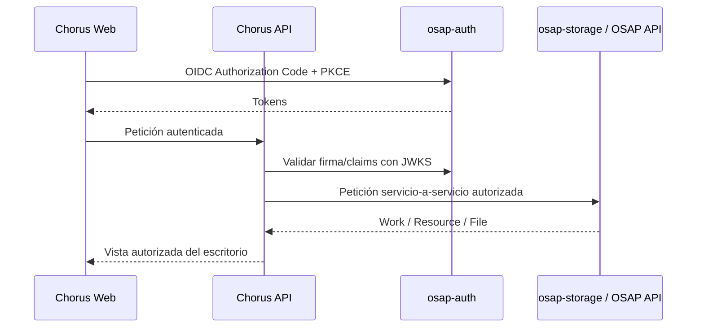

# Contratos de integración: estado comprobado y límites

Este documento distingue contratos observados en el código de decisiones todavía pendientes. No autoriza a Chorus a llamar rutas internas desde el navegador ni a depender de endpoints no versionados.

## 1. Identidad: osap-auth

### Contrato observado

El repositorio `AI_osap-auth` implementa un proveedor de identidad OIDC:
- discovery: `/.well-known/openid-configuration`;
- autorización: `/auth/authorize`;
- token: `/oauth/token`;
- JWKS: `/auth/.well-known/jwks.json`;
- scopes OIDC declarados: `openid`, `profile`, `email`;
- Authorization Code con PKCE S256;
- algoritmo de firma anunciado: RS256.

También existe `GET /auth/me`, que devuelve el perfil del usuario autenticado mediante la dependencia de sesión actual.

### Decisión para Chorus

- El frontend debe integrarse como cliente OIDC con Authorization Code + PKCE.
- El backend Chorus debe validar tokens mediante JWKS y validar issuer, audience, firma, expiración y claims requeridos.
- El sujeto autenticado (`sub`) es la referencia de propiedad personal.
- No aceptar `owner_user_id`, `created_by_user_id` ni identidades equivalentes desde el cuerpo del cliente cuando se trate de acciones propias del usuario.
- No implementar un login paralelo ni guardar contraseñas de OSAP en Chorus.
- Registrar Chorus como cliente OIDC en osap-auth mediante el procedimiento administrativo correspondiente; no inventar client_id ni redirect_uri.
- No asumir que los scopes OIDC actuales son suficientes para permisos de Chorus. La autorización de grupos y recursos privados pertenece a Chorus.

La implementación concreta debe contrastarse con la configuración de despliegue y la política de cookies/tokens de osap-auth antes de escribir el cliente.

## 2. Catálogo y recursos: OSAP / osap-storage

### Contrato y arquitectura observados

El README de `AI_osap-storage` declara que Storage gestiona datos de catálogo (Works, compositores y relaciones), Resources y Files. Está diseñado para acceso autorizado servicio-a-servicio, no para acceso directo desde un cliente web público.

La dirección de V6 documentada es Work → Resource → File. La misma documentación advierte que el código actual aún conserva partes de la implementación anterior y que los documentos V6 describen el destino, no una migración ya completada.

### Decisión para Chorus

- El navegador nunca se conecta directamente a MariaDB ni a rutas privadas de Storage.
- Chorus backend media las peticiones y aplica propiedad, permisos y contexto de usuario.
- Los contratos V6 publicados en Storage serán la fuente para integración de catálogo y ficheros.
- No usar nombres de rutas actuales como contrato estable si no están incluidos en OpenAPI versionado.
- No escribir todavía un cliente de catálogo o de ficheros hasta contrastar el OpenAPI V6 con la versión realmente desplegada.
- Los identificadores de Work, Resource y File se tratan como identificadores opacos del servicio que los emite.
- Añadir una Work o Resource al escritorio crea una relación personal de Chorus; no duplica el objeto OSAP.
- Los archivos privados y los borradores se gestionan con operaciones autorizadas del servicio de almacenamiento. La ruta física o la clave R2 no se expone al navegador.

## 3. Contrato anterior ScoreContract

El `ScoreContract` de `src/chorus/contract` es un contrato distinto y de propósito limitado: transporta datos resumidos de un Score validado para la generación de materiales.

No sustituye los contratos Work, Resource o File. Su revisión está en [score-contract-review.md](score-contract-review.md).

## 4. Integración entre servicios

El diagrama es conceptual. No fija todavía los endpoints, credenciales de servicio ni el mecanismo de delegación de permisos hacia Storage.

## 5. Verificaciones pendientes

- [ ] Registrar Chorus como cliente OIDC y validar redirect URIs de desarrollo/producción.
- [ ] Confirmar issuer, audience, expiración y claims exactos de los tokens emitidos para Chorus.
- [ ] Confirmar si Chorus recibirá tokens de usuario, tokens de servicio o ambos y cómo se delegará autorización a Storage.
- [ ] Leer el documento OpenAPI V6 completo y contrastarlo con la API desplegada.
- [ ] Identificar endpoints reales para búsqueda de Work, consulta de Resource y acceso a File.
- [ ] Definir operaciones privadas de carga, descarga y publicación.
- [ ] Añadir pruebas de contrato con dobles y pruebas de integración en entorno no productivo.

Hasta cerrar estos puntos, no se codifican URLs, scopes ni payloads de API supuestos.
